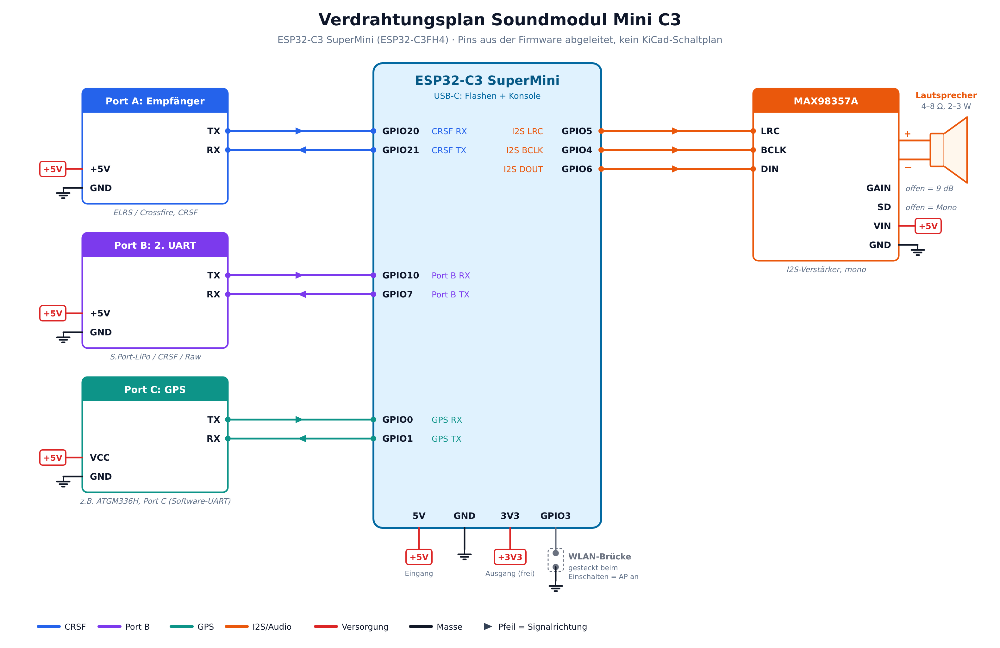

# Soundmodul Mini (C3)

Kompaktes Soundmodul für Motorgeräusche und Effekte auf Basis ESP32-C3 (C3FH4, 4 MB Flash).
Abgeleitet von [ESP32-RC-Sound V7](https://github.com/mnorden81/mnorden81-ESP32-Sound-bidirectional_code), reduziert auf:

- **Eingang:** nur CRSF (Port A), busbasiert
- **Sounds:** Motor (Start/Loop/Stopp) + 4 Zusatzsounds
- **Speicher:** Flash (LittleFS), SD-Karte optional
- **Ports:** Port A (CRSF), Port B (zweiter UART), Port C (GPS per SoftwareSerial; der C3 hat nur zwei Hardware-UARTs)
- **Web-UI:** Sound-Upload und OTA-Update per WLAN
- **Verstärker:** MAX98357A (I2S)

**Aktuelle Version:** noch keine (Grundgerüst)

Projektplan: siehe `docs/`.

## Flash-Aufteilung (4 MB)

2 × 1,25 MB Firmware (OTA) + ca. 1,3 MB Sounds (≈ 30 s bei 22,05 kHz, 16 Bit mono).

## Bauen

```bash
cd firmware
pio run                 # Firmware bauen
pio run -t upload       # flashen
pio run -t uploadfs     # Sounds aus firmware/data/ ins Flash
```

## Hardware

Bauplan mit Bauteilliste, Pinbelegung und Grafiken: [`docs/Hardware-Bauplan_Mini-C3.docx`](docs/Hardware-Bauplan_Mini-C3.docx).
Board: ESP32-C3 SuperMini. Die Pinbelegung ist ein **Vorschlag** für die noch fehlende C3-Firmware (Strapping-Pins 2, 8, 9 bleiben frei). Keine SD-Karte beim C3, Sounds nur im Flash.



| Funktion | GPIO |
|---|---|
| Port A CRSF RX / TX | 20 / 21 |
| Port B RX / TX | 10 / 7 |
| Port C GPS RX / TX (Software-UART) | 0 / 1 |
| I2S BCLK / LRC / DOUT (MAX98357A) | 4 / 5 / 6 |
| WLAN-Brücke (nach GND) | 3 |

## Ordner

- `firmware/` PlatformIO-Projekt
- `hardware/` Schaltplan, PCB
- `docs/` Pinout, Changelog
- `backups/` funktionierende Stände (nur lokal, nicht im Repo)

## Lizenz

GPL-3.0, wie das Ursprungsprojekt (enthält Code von XTronical).
